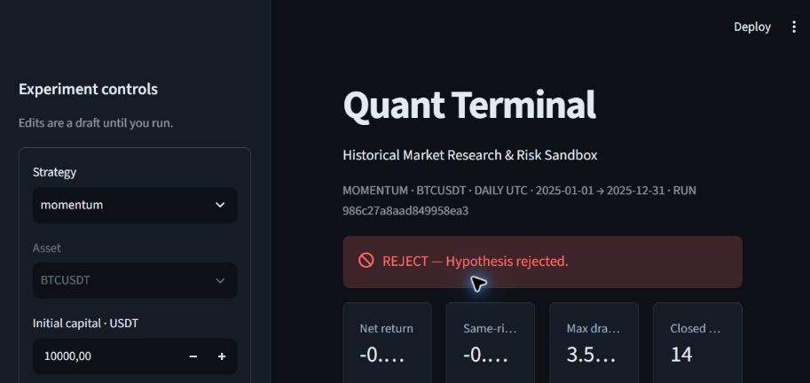
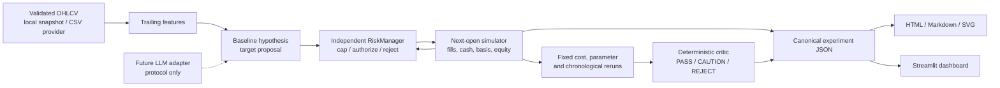

# Quant Terminal

Agentic market research and risk sandbox.

[](https://github.com/dancho133/quant-terminal/actions/workflows/ci.yml)

Quant Terminal runs two transparent baseline hypotheses through historical simulation, independent risk controls and a deterministic research critic. Each run produces a complete accounting ledger, reproducible experiment identity, robustness checks and an exportable research report. A small Streamlit dashboard displays those same results and lets you rerun the experiment with explicit parameters. The included historical snapshot makes the demonstration work without a market-data service or an LLM key after dependencies are installed.

**AI proposes. Evidence tests. Risk constrains. Critic challenges.**

This repository is a research/paper-trading prototype and is not financial advice or a claim of profitable trading performance.

## Quickstart

Prerequisites: [uv](https://docs.astral.sh/uv/getting-started/installation/), Git and a browser. Python 3.12 is selected by the project; uv can obtain it if missing. The first installation needs internet access. Subsequent runs use local data and installed packages.

```sh
git clone https://github.com/dancho133/quant-terminal.git
cd quant-terminal
uv run --locked quant-terminal-demo
```

The **one-command demo** generates both baseline experiments under `artifacts/<experiment-id>/` and starts the dashboard at [http://127.0.0.1:8501](http://127.0.0.1:8501). Open that address; press Ctrl+C in the terminal to stop the server.

CLI experiment:

```sh
uv run --locked python -m quant_terminal.run --strategy momentum --asset BTCUSDT --initial-capital 10000
```

Both experiments without a server:

```sh
uv run --locked quant-terminal-demo --no-ui
```

After the dependencies are installed, explicitly offline:

```sh
uv run --offline --locked quant-terminal-demo --no-ui
```

## What the demonstration shows

Default snapshot: **1,096 daily BTCUSDT bars, 2023-01-01 through 2025-12-31**. Earlier bars provide feature context; **2025** is the retrospective evaluation period. There is no claim that this is an untouched holdout.

| Baseline | Net evaluation return | Same-risk constant-long | Maximum drawdown | Closed episodes | Critic |
|---|---:|---:|---:|---:|---|
| Momentum, MA 20/50 | −0.62% | −0.48% | 3.56% | 14 | REJECT |
| Mean reversion, 20-day z-score | +4.76% | −0.48% | 5.63% | 15 | CAUTION |

These are computed historical simulations for the declared snapshot and defaults, **not live trading results**. The positive mean-reversion result remains inconclusive. The momentum report explicitly concludes **“Hypothesis rejected.”**

An actual CLI output includes:

```text
Experiment bbc87bc1d4ee46e327d3 | momentum | BTCUSDT
Evaluation: 2025-01-01 .. 2025-12-31
Return -0.62% | same-risk comparator -0.48% | gross buy-and-hold -7.34%
Max drawdown 3.56% | closed episodes 14 | fills 123 | costs 108.06 USDT
Critic REJECT: Hypothesis rejected.
```

The ID depends on normalized configuration, OHLCV content, provenance and numerical source hashes. It is not a random label or wall-clock timestamp.

[Example artifacts and their exact run IDs](examples/README.md) · [Reproduction guide](DEMO.md)



The screenshot is from a fresh session of the running application. Charts and tables are calculated from the included dataset. The [performance capture](docs/images/dashboard-performance.jpg) shows the comparison chart.

## Architecture



The numerical engine uses the Python standard library. Streamlit and its Pandas dependency serve the dashboard; Matplotlib renders standalone report figures. There is no database, broker, task queue, agent framework or hidden API requirement.

```text
quant_terminal/
  models.py           validated configuration and OHLCV contracts
  data.py             local CSV provider; optional public archive importer
  sample_data/        historical CSV, checksum/provenance manifest and notice
  features.py         returns, MAs, volatility, momentum, volume change, z-score
  strategies.py       hypothesis, assumptions, parameters and target logic
  risk.py             target caps, order authorization and drawdown latch
  backtest.py         next-open fills, cost basis, episodes and marked ledger
  critic.py           visible screening thresholds and structured findings
  experiment.py       content identity, comparator and fixed robustness reruns
  reports.py          self-contained HTML, Markdown, SVG and trade CSV
  agents.py           future Research/Strategy/Risk/Critic protocols
  run.py              experiment CLI
  demo.py             one-command artifacts and dashboard launcher
  dashboard/app.py    Overview / Performance / Trades / Risk / Research
tests/                arithmetic, causality, risk, critic, CLI and UI checks
examples/             executed demonstration artifacts
docs/                 research design, architecture decisions and screenshot
.github/workflows/    Linux/Windows verification and offline demo
```

## Research philosophy

Both strategies propose either **40% long exposure or cash**, then the independent gate applies the configured limits. Momentum enters when the trailing fast MA exceeds the slow MA and trailing momentum is positive. Mean reversion enters at z-score ≤ −1 and exits at z-score ≥ 0; its holding state is explicit. These are baseline hypotheses, not proprietary alpha.

There is no parameter optimizer. The critic sees base/zero/double costs, two predetermined neighboring window parameters and two chronological half-window reruns. Each subwindow starts with fresh capital and uses only earlier context for its indicators. The variants challenge the chosen configuration; the runner never promotes the best variant.

The two strategies were chosen retrospectively, on one familiar market. Multiple runs, nearby parameters and a chronological split do not establish statistical significance, independence or profitability.

## Execution and risk controls

- Signals use information through close **t**, and resulting orders fill at open **t+1**.
- Long-only fractional BTC, one asset, no borrowing or leverage.
- Adverse slippage changes the fill price; fees reduce cash on both buys and sells.
- Target sizing solves exposure against **post-cost equity**. Default position cap is 25%, maximum exposure 50%; the tighter limit governs the single asset.
- Every actual order passes independent affordability, no-short and exposure checks. Capped targets preserve the original proposal and allowed value.
- Drawdown is sampled at closes. Crossing the limit permanently blocks new entries and schedules liquidation at the next available open.
- Prices can drift above exposure caps or gap beyond a drawdown threshold before the next adjustment. These events and the delay are visible.
- The final bar is marked. Outstanding targets are unfilled, open holdings and unrealized PnL remain explicit, and an estimated future exit cost is shown separately.

The full-exposure gross buy-and-hold line is context. The constant-long comparator uses the **same costs, risk gate, capital, calendar and target proposal**; its actual exposure path can still differ.

## Critic design

The critic returns structured checks with observed values, thresholds, severity and reasons. Negative evaluation return, failure of the stated comparator-relative hypothesis, a drawdown halt or specified cost fragility can produce REJECT. Few completed episodes, concentration, unstable windows, sensitive parameters or retrospective selection produce CAUTION.

A successfully rejected order demonstrates functioning protection and does not by itself reject the hypothesis. PASS means only that the declared screening checks passed. It is neither a calibrated probability nor trading permission. The test suite contains constructed PASS, CAUTION and REJECT specimens.

## Verification

```sh
uv sync --locked --group dev
uv run --locked ruff format --check .
uv run --locked ruff check .
uv run --locked python -m unittest discover -s tests -v
uv run --offline --locked quant-terminal-demo --no-ui
uv build
```

Tests include hand-calculated fees/slippage and PnL, future-bar mutation, target caps, rejected orders, next-open drawdown liquidation, unresolved final-close risk, cost-basis reconciliation, critic behavior, experiment identities, exported reports and actual Streamlit submissions.

[Recorded verification](examples/verification.md), including a fresh clone of the published repository. The [CI workflow](.github/workflows/ci.yml) runs lint, formatting, all tests, the offline demo and packaging on Linux and Windows with Python 3.11 and 3.12. Inspect [GitHub Actions](https://github.com/dancho133/quant-terminal/actions) for the current remote result.

## Data and licensing

The snapshot was downloaded from [Binance Vision public spot archives](https://github.com/binance/binance-public-data), including verification of all 36 original archive checksums. Prices were not synthesized, backfilled or adjusted. Test-only synthetic fixtures exercise arithmetic and are labeled accordingly.

Program code is MIT-licensed. **The historical dataset and derived example charts/reports have separate noncommercial CC BY-NC-SA 4.0 and supplemental upstream terms.** See [dataset attribution](quant_terminal/sample_data/NOTICE.md) and the [upstream terms](https://github.com/binance/binance-public-data/blob/master/TERMS_AND_CONDITIONS.md). Commercial data use needs an appropriately licensed provider.

Optional explicit-network archive import to a **new** file:

```sh
uv run --locked python -m quant_terminal.data --asset BTCUSDT --start 2025-01 --end 2025-12 --output artifacts/imported/BTCUSDT-1d.csv
```

A user CSV must have exactly `timestamp,open,high,low,close,volume`, daily consecutive bars at 00:00 UTC and valid finite OHLCV. Pass it with `--data path/to/file.csv --start YYYY-MM-DD --end YYYY-MM-DD`. Unknown assets fail rather than substituting BTC data.

## Limits and roadmap

There is no live trading, actual broker paper account, intrabar execution, realistic market impact, funding, tax or exchange lot-size model. Returns include marked open positions; win rate includes only fully closed episodes. Annualized volatility and the Sharpe-like metric use daily scaling and a zero cash risk-free rate, without serial-correlation or selection adjustments.

`ResearchAgent`, `StrategyAgent`, `RiskAgent` and `CriticAgent` are typed integration protocols. No LLM or autonomous agent implementation exists. Any future AI proposal must still pass the numerical risk gate.

The next useful improvements are:

1. A genuinely prospective walk-forward evaluation and a documented experiment registry with selection-bias controls.
2. A properly licensed multi-asset dataset with portfolio-level accounting and exposure constraints.
3. A measured execution model for spreads, liquidity and lot rules, followed by a separate observable broker paper adapter.

Before any live deployment, the work in [research_design.md](docs/research_design.md) would need independent review, realistic replay, operational controls and extended paper/shadow evidence.
