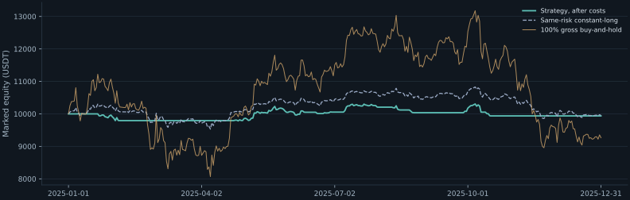
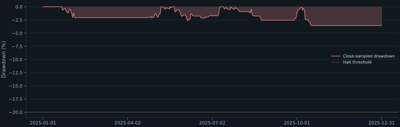
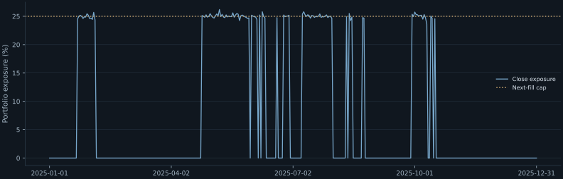

# Quant Terminal — Research report

Historical Market Research & Risk Sandbox

**Experiment:** 986c27a8aad849958ea3  
**Strategy:** momentum · **Asset:** BTCUSDT  
**Evaluation:** 2025-01-01 — 2025-12-31  
**Critic:** REJECT

## Hypothesis

A trailing trend filter improves evaluation-period return over the same-risk constant-long comparator after costs.

## Dataset

1096 daily bars: 2023-01-01 — 2025-12-31.
Source: Binance Vision spot archives.
Normalized OHLCV SHA-256: c2d7fb5f1c417ebe63a471b88ae2df27c80e0cb7de95e4361ea5ae0f98628c91.
Feature context before evaluation: 731 bars.
The evaluation window is a retrospective split, not proven untouched out-of-sample evidence.

## Parameters and assumptions

~~~json
{
  "asset": "BTCUSDT",
  "costs": {
    "fee_bps": 10.0,
    "slippage_bps": 5.0
  },
  "evaluation_end": "2025-12-31",
  "evaluation_start": "2025-01-01",
  "initial_capital": 10000.0,
  "params": {
    "fast": 20,
    "lookback": 20,
    "slow": 50
  },
  "periods_per_year": 365,
  "risk": {
    "max_drawdown": 0.2,
    "max_exposure": 0.5,
    "max_position": 0.25
  },
  "strategy": "momentum"
}
~~~

- Daily trends persist into the next bar.
- Open-price fills approximate executable liquidity.

## Results and metric limitations

| Metric | Value | Limitation |
|---|---:|---|
| total_return | -0.62% | Marked equity change; includes unrealized holdings, excludes their eventual exit cost. |
| benchmark_return | -7.34% | 100% gross buy-and-hold, entered at the second evaluation bar open; contextual, with different risk and zero costs. |
| same_risk_benchmark_return | -0.48% | Constant 40% proposal, independently capped, rebalanced, costed and halted using identical rules; exposure paths can still differ. |
| max_drawdown | +3.56% | Peak-to-trough portfolio equity at daily closes; intrabar losses and close-to-open liquidation gaps can be worse. |
| annualized_volatility | +4.91% | Sample SD of daily portfolio returns times sqrt(365); assumes daily sampling and stable scaling. |
| sharpe_like | -0.10 | Mean daily return / sample SD times sqrt(365), zero cash risk-free rate; no serial-correlation or selection adjustment; null for zero variance. |
| win_rate | +42.86% | Profitable fully closed position episodes / closed episodes. Partial exits and unrealized holdings are excluded. |
| turnover | 7.20 | Gross traded fill notional / initial capital over this evaluation period; includes daily rebalancing. |
| number_of_trades | 14 | Completed position episodes, not individual fills; a final open episode is excluded. |
| transaction_costs | 108.06 | Fees plus adverse slippage versus opening mid price; no order-book impact, funding, taxes or minimum-lot model. |

## Equity and risk

Risk halt: False. Ending holdings: 0.00000000 BTC.
Ending cash: 9938.17 USDT; unrealized PnL: 0.00 USDT.
Estimated remaining exit cost (not deducted from marked return): 0.00 USDT.
Final-close proposals have no execution bar; no forced terminal exit is fabricated.

## Critic analysis

A deterministic screening verdict, not a statistical significance test or permission to trade.

- **CAUTION · FEW_TRADES**: Win rate from few completed position episodes is weak evidence. Observed=14; threshold=20.
- **REJECT · NEGATIVE_RETURN**: Evaluation-period marked return is negative after modeled costs. Observed=-0.006183409929478856; threshold=0.
- **REJECT · BENCHMARK_UNDERPERFORMANCE**: The declared improvement hypothesis failed against the identical-risk constant-long comparator. Observed=-0.0013849317482028667; threshold=0.
- **REJECT · WEAK_AFTER_COSTS**: A gross-positive result disappears after base transaction costs. Observed=-0.006183409929478856; threshold=0.
- **CAUTION · WINDOW_INSTABILITY**: A nonpositive chronological subwindow shows regime dependence. Observed=[0.0056392402289850985, -0.011756353258224217]; threshold=both fixed chronological windows positive.
- **CAUTION · CONCENTRATION**: Invested capital is concentrated in one market; this is not a diversified portfolio. Observed=1.0; threshold=0.8.
- **CAUTION · RETROSPECTIVE_SELECTION**: A retrospective split and familiar baseline parameters cannot establish untouched out-of-sample evidence. Observed=True; threshold=False.

## Fixed robustness checks

Fixed +/-20% neighboring window parameters; base/zero/double costs; chronological half-window resets. Prior bars supply feature warm-up. No best variant selection.

| Scenario | Net return | Closed episodes |
|---|---:|---:|
| zero_cost | +0.46% | 14 |
| base_cost | -0.62% | 14 |
| double_cost | -1.68% | 14 |
| fast=16 | -1.34% | 15 |
| fast=24 | -1.81% | 15 |
| first_half: 2025-01-01—2025-07-01 | +0.56% | 7 |
| second_half: 2025-07-02—2025-12-31 | -1.18% | 7 |

## Failure modes

- Whipsaw in sideways regimes.
- Late exits after gaps.
- Costs consume small trend moves.

The simulator omits intrabar execution, market impact, exchange lot rules, funding, taxes and live liquidity.
Single-asset and baseline-selection bias remain. No statistical significance claim is made.

## Conclusion

**Hypothesis rejected.**

Baselines propose. Historical evidence tests. Risk constrains. Rules challenge.

This is a historical research simulator, not a broker paper account, financial advice or a claim of profitable trading performance.

Historical dataset and derived example outputs: Binance Vision, CC BY-NC-SA 4.0 and supplemental dataset terms. Code: MIT. No affiliation is implied.
